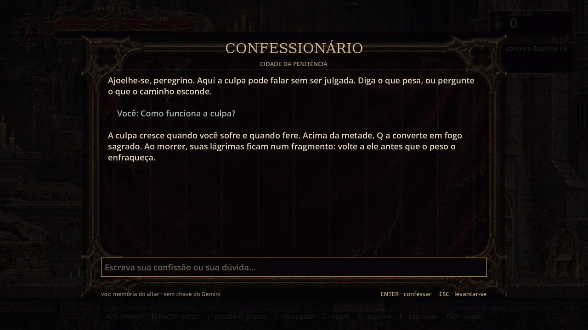

# Lacrimae of the Penitent

Jogo de ação e exploração 2D, sombrio e gótico, sobre **culpa e fé**. Feito no Godot 4.6.

Um guerreiro sem memória desperta num túmulo. A inscrição diante dele o acusa de ter condenado milhares de pessoas. Ao lado de Beatriz, uma carrasca que nunca olhou o rosto de quem feriu, ele atravessa uma cidade que não consegue enterrar os seus mortos para descobrir o que fez.

> A culpa não queria castigo. Queria ser olhada.

## Como jogar

1. Instale o **Godot 4.6.3 Standard** (não precisa da versão .NET).
2. No Godot, escolha **Importar** e abra o arquivo `project.godot` desta pasta.
3. Espere a importação terminar e aperte **F5**.

No Windows, também dá para usar `Jogar-Windows.cmd`.

## O que há no jogo

- **Onze lugares** interligados: a Cidade da Penitência, seis salas do percurso principal, três salas secretas e o Vale dos Flagelados.
- **Dois personagens jogáveis ao mesmo tempo:** o Penitente (espada) e Beatriz (lança). Beatriz luta sozinha ou nas mãos de uma segunda pessoa.
- **Combate:** sequência de quatro golpes, corte ascendente, golpe carregado, investida, dois golpes no ar, golpe descendente, Lâmina de Sangue, aparo com bloqueio e contra-ataque, esquiva e **seis execuções diferentes** que desmembram as criaturas.
- **Crescer na jornada:** oferendas no altar (vida, força e frascos) e cinco relíquias escondidas (Cálices de Sangue dão vida, Espinhos da Ira dão força).
- **Dois chefes:** o Guardião dos Sinos e o Flagelado.
- **Dezessete criaturas**, muitas inspiradas nas Pinturas Negras de Goya, cada uma com aviso, ataque e abertura próprios.
- **Confessionário com IA:** um personagem que responde às perguntas de quem joga (veja abaixo).
- **História com começo, meio e fim**, com uma cutscene de revelação no final.
- Altares para salvar, penitências equipáveis, mapa, trilha sonora com coro e cenários animados.

## Controles

| Ação | Teclado | Controle |
|---|---|---|
| Mover | A / D | Analógico ou direcional |
| Pular (S + pulo desce de uma galeria) | Espaço ou W | A |
| Atacar (sequência de 4; 2 golpes no ar) | J ou X | X |
| Corte ascendente (toque rápido) | I | RT |
| Golpe carregado (segurar e soltar) | Segurar I | Segurar RT |
| Golpe descendente | S + J no ar | ↓ + X no ar |
| Investida | J logo depois da esquiva | X logo depois da esquiva |
| Lâmina de Sangue (gasta um quarto da culpa) | U | R3 |
| Aparar (golpes com brilho dourado) | L | RB |
| Esquivar | K ou Shift | B |
| Interagir, orar, executar | E | Y |
| Curar | F | LB |
| Penitência (com a culpa acima da metade) | Q | LT |
| Doar sangue / levantar a parceira | H | ↑ |
| Confessionário (fora de combate) | C | Segurar Y |
| Mapa | TAB | Back |
| Pausa | Esc | Start |

Quando uma ação é possível, a tecla aparece acima do objeto ou da criatura.

No altar: **E** ora (salva, cura e traz os inimigos de volta), **R** abre as oferendas (lágrimas por mais vida, mais força ou mais um frasco), **V** troca de penitência.

Aparo: o golpe aparável brilha em dourado antes de sair. Aparar um pouco tarde ainda bloqueia três quartos do dano, e apertar o aparo logo depois de levar o golpe devolve a vida e abre o inimigo.

Outras teclas: **M** som, **F11** tela cheia, **P** reduz clarões e tremores, **F6** liga ou desliga os cenários animados (use se o jogo ficar lento).

### Segunda pessoa (Beatriz)

Beatriz faz tudo o que o Penitente faz: os mesmos golpes, aparo, Lâmina de Sangue e execuções. As lágrimas que ela recolhe vão para a mesma bolsa, e as oferendas do altar valem para os dois.

O primeiro comando da segunda pessoa assume Beatriz; **F4** devolve o controle ao jogo.

- **Teclado numérico:** setas movem, ↑ pula, **1** ataca, **3** esquiva, **4** apara, **5** corte ascendente ou golpe carregado, **7** Lâmina de Sangue, **6** cura, **0** doa sangue, **Enter** interage e executa.
- **Notebook sem teclado numérico:** **.** ataca, **,** esquiva, **;** apara, **Ç** corte ascendente ou golpe carregado, **=** Lâmina de Sangue, **~** cura, **´** interage, **[** doa sangue.
- **Segundo controle:** os mesmos botões do primeiro.

## O Confessionário (IA)

A tecla **C**, em qualquer lugar e fora de combate, abre o Confessionário. O jogador escreve uma pergunta, ou escolhe uma das perguntas prontas, e o **Confessor** responde no tom do jogo: explica controles, dá pistas de caminho, dá dicas de combate e reconta a história já descoberta, sem entregar o final.

O Confessor é um modelo de linguagem (Gemini) que recebe, a cada pergunta, o estado real da partida: onde o jogador está, o que falta fazer, quantas vezes morreu e onde.

Para ligar a IA:

1. Crie uma chave gratuita em <https://aistudio.google.com/apikey>.
2. Copie `ia_local.cfg.exemplo` como `ia_local.cfg` e cole a chave.
3. Jogue e aperte **C**.

**Sem chave ou sem internet o Confessionário continua funcionando**, com respostas prontas por assunto. O rodapé do painel mostra quem respondeu. O arquivo da chave fica fora do repositório. Detalhes em [docs/confessionario.md](docs/confessionario.md).

## Para avaliar

- **F3** abre o modo de desenvolvimento: ↑/↓ escolhem a sala, Enter transporta, **B** vai ao chefe, **G** liga a invencibilidade e **N** o voo.
- [Guia de apresentação](docs/guia-de-apresentacao.md): um roteiro de dez minutos para mostrar o jogo.
- [Documentação do jogo](docs/documentacao/) e [pranchas de conceito](docs/pranchas/).

## Equipe

Projeto acadêmico de Rodrigo, Mateus, Bárbara e Nicole. Código em GDScript, com testes automáticos em `tests/`.

## O que vem depois

O jogo termina com uma verdade e deixa uma pergunta. O Penitente descobre **de quem eram as mãos** que fecharam os portões. Falta saber **de quem foi a ordem**. Os portões levam à Grande Basílica.
