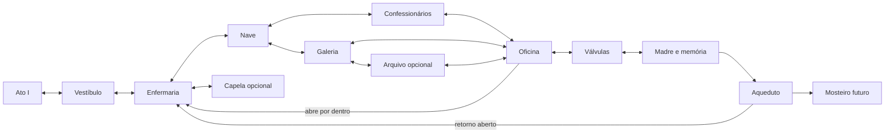

# Ato II — esboço jogável da Basílica Profanada

**Estado: proposta para decisão do autor.** Não inicia a produção do Ato II. Arte, código, falas e textos de objetos não foram criados. O início depende de o autor jogar o Ato I e relatar o que sentiu, conforme o pedido da v16. A proposta segue as seções II.1–II.5 de [roteiro-cinco-atos.md](roteiro-cinco-atos.md); não transforma suas sugestões em fatos já aprovados.

## Objetivo e mudança dramática

O Penitente entra buscando compreender a ordem dos portões. A travessia leva ao reservatório da Madre Dolorosa e à descoberta obrigatória de que participou da criação do Lacrimae Sacramentum. O ato deve deslocar sua investigação de um mandante externo para sua própria participação, sem concluir que a intenção inicial de ajudar o absolve.

A Basílica precisa parecer uma instituição que antes cuidava e depois passou a produzir sofrimento: acesso monumental para fiéis, corredores de serviço privilegiados, salas de atendimento, instrumentos padronizados e tubulações convergentes. A construção e os trajetos contam essa mudança antes da memória. O ritual oferecia alívio real; os fiéis não eram simplesmente ingênuos, e Edran não deve existir apenas para explicar a trama.

## Estrutura espacial proposta

Nove salas principais, duas opcionais e dois retornos abertos por dentro. São unidades de exploração extensas, com percursos verticais e marcos próprios; não onze painéis de fundo desconectados. Portas, escadas, tubulações e níveis devem se corresponder de ambos os lados de cada passagem. Um corte breve só ocorre numa mudança física compreensível de ambiente.

| ID / local | Forma e função | Conteúdo / consequência |
|---|---|---|
| A1 — Vestíbulo das Petições | Exterior estreito que se abre numa nave; visão antecipada do reservatório distante | Orientação de entrada e conexão de volta ao Ato I; nenhum novo chefe ou tutorial longo |
| A2 — Enfermaria | Núcleo seguro lateral, leitos efetivamente usados; escada de serviço visível mas trancada | Edran, primeiro altar; cuidado sem confissão obrigatória; encontro inicial curto, perguntas extras opcionais |
| A3 — Nave dos Comparecimentos | Bancos numerados, dois pavimentos e fila interrompida por desabamento | Primeiro encontro com o contraste entre acolhimento antigo e norma compulsória; escolha entre rota baixa e alta |
| A4 — Confessionários inferiores | Trecho horizontal alternado com poços rasos e saídas laterais claras | Pressão de combate em espaços curtos; lista de moradores convocados; primeira rota à oficina |
| A5 — Galeria dos Copistas | Subida em volta da mesma nave, com visão do caminho inferior | Rota de plataforma com menor densidade de combate; livro de primeiros atendimentos; segunda rota à oficina |
| A6 — Oficina de Admissão | Ambiente de manutenção com bancada central e circuito de saída curto | Mudança dos registros de cuidado para volume extraído; ferramenta proposta; atalho por dentro até A2 |
| A7 — Câmara das Válvulas | Dois níveis, tubos com origem e destino visíveis | Aprendizado de isolamento de uma linha, sem romper recipiente; segundo altar fora do alcance dos ataques do chefe |
| A8 — Reservatório do Coro | Arena sob a nave; passagens firmes e correntes legíveis | Madre Dolorosa, interrupção da coleta e segunda memória; volume já armazenado permanece |
| A9 — Aqueduto Alto | Saída de manutenção ascendente, com reencontro de Edran próximo ao retorno | Conversa curta posterior; rota para o Mosteiro; retorno à enfermaria e à Cidade continua disponível |
| O1 — Arquivo de Manutenção | Desvio da galeria A5; rota opcional que retorna a A6 | Registro parcial sobre admissão e receptáculo; pista para o desmonte final, nunca um manual completo da solução |
| O2 — Capela dos Leitos Vazios | Desvio junto à enfermaria, aberto após a oficina | Vestígio de cuidado cotidiano; espaço de observação e descoberta opcional, sem moeda por sofrer |

A4 e A5 são alternativas reais: completar uma dá acesso à progressão, percorrer ambas acrescenta contexto. O documento essencial de mudança de finalidade fica na convergência A6, para a compreensão central não depender de escolher a rota certa. Nenhum segredo condiciona a memória de autoria do ritual.

O atalho A6–A2 reduz o retorno desde a oficina; o acesso A9–A2 permite rever Edran e recuperar objetos do Ato I sem repetir a arena. Antes de derrotar a Madre, a arena oferece recuo até o confronto ser ativado. Depois da derrota, permanece uma conexão física atravessável. Não apagar rotas para forçar o próximo ato.

## Progressão e ferramenta: decisão do autor

O roteiro propõe o **Passo entre grades** em A6. Falta definir alcance, animação, custo e distinção em relação à esquiva e ao salto duplo existentes. Proposta: atravessar somente grades explicitamente permeáveis, com espessura visual consistente; não atravessar qualquer parede, inimigo ou ataque. Demonstrar uma grade acessível antes de adquirir a ferramenta e testá-la num circuito sem morte dentro da oficina, com saída comum de segurança.

Se aprovada, a ferramenta abre a rota de serviço de A6 a A7 e um retorno opcional ao depósito de plantas do Arquivo do Ato I. Esse depósito é uma ampliação futura, não conteúdo já existente. Abertura do atalho A6–A2 deve ser uma tranca física independente da habilidade, para nunca depender de recurso consumível. Se o autor rejeitar a habilidade, substituir a grade principal por um mecanismo de manutenção; manter os dois caminhos e a revelação. Não iniciar arte ou código da ferramenta antes dessa decisão.

## Criaturas e distribuição

| Encontro | Reaproveitamento / novidade proposta | Função e limite |
|---|---|---|
| Devotos e plangentes | Reutilizar a base existente, com encontros curtos na nave e galeria | Cobrar distância, esquiva e leitura do ataque; não aumentar vida só para alongar a travessia |
| Flagelante | Reutilizar em A4/A7, com espaço lateral suficiente | Pressão em corredor; nunca atacar de trás de uma porta durante a chegada |
| Bruxas do aquerlarre | Um encontro opcional em O1, se a proteção estiver compreensível no Ato I | Incentivar prioridade de alvos; evitar sobrepor proteção, projéteis ocultos e plataforma estreita |
| Sacerdote coletor | Criatura nova proposta; silhueta de recipiente e tubos, sem coroa confundível com o herói | Ataque de sucção anunciado que exige reposicionamento; não retirar progressão, relíquias ou moeda permanentemente |
| Confessionário vivo | Criatura nova proposta; móvel reconhecível, abertura visível | Emboscada limitada a portas falsas claramente distintas das passagens reais; cancela pressão ao recuar; não disfarçar toda saída navegável |
| Madre Dolorosa | Chefe novo, único confronto principal | Usa a rede de correntes/coletores aprendida em A7, com narrativa própria |

Preferência de escopo: dois inimigos novos e um chefe; não acrescentar um bestiário inteiro antes de testar o existente. Devorador, Asmodeia e duelistas não precisam aparecer apenas para preencher salas. Cadáveres, sobreviventes e fiéis não hostis devem ter identificação inequívoca. Nenhum progresso, cura ou finalização exige atacar uma pessoa indefesa.

## Madre Dolorosa — combate proposto

Duas etapas de um mesmo sistema, sem recuperação integral de vida entre elas. Primeiro, reconhecer a corrente de alimentação ativa e interromper seu comando para criar uma janela de ataque. A segunda etapa combina sinais já aprendidos e muda uma passagem da arena; não introduz uma fraqueza sem aviso na metade final.

A7 demonstra isolar uma linha secundária de manutenção. A vitória em A8 interrompe a entrada principal de lágrimas, não esvazia o reservatório nem prova que destruí-lo seria seguro. Tubos que continuam cheios e gotejamento residual sustentam essa diferença. Os apoios essenciais permanecem sólidos: mudanças de passarela não podem criar quedas inevitáveis durante animação travada. Checkpoint próximo, ingresso curto e possibilidade de repetir sem repetir exposição longa.

Telegráficos devem combinar pose, trajetória e som legendado. Opção de reduzir pulsos precisa abranger as cenas novas por contrato; os sinais de ataque não podem depender de clarões. Invulnerabilidade e abertura precisam de leitura visual clara. Quantidades de dano, durações e número de tentativas são decisões de protótipo e playtest, não valores já balanceados.

## Cenas de culpa e limites das revelações

| Momento | Forma proposta | Revela | Não revela |
|---|---|---|---|
| Entrada e fila | Ambiente jogável, sem bloqueio de controle | O acolhimento foi transformado em obrigação administrativa | A autoria do instrumento, a entidade ou o destino da família de Iria |
| Primeiro encontro com Edran | Interação obrigatória breve; aprofundamento opcional | Participação institucional na transmissão da ordem, se o autor aprovar esse papel | Que ele controla todas as memórias ou é o único responsável |
| Oficina | Comparação de documentos e instrumentos, leitura essencial curta | A mesma técnica passa a medir extração em vez de bem-estar | Identidade nominal completa do protagonista ou pedido de esquecimento |
| Entrada da Madre | Cena curta centrada no vínculo entre mãos, correntes e instrumento | A instituição reconhece o trabalho do Penitente | Ainda não uma explicação integral do passado |
| Queda da Madre e segunda memória | Cuidado de uma pessoa no passado, instrumento multiplicado, desenho assinado; retorno ao presente | O Penitente criou parte do ritual e sabia que a dor extraída permanecia armazenada | Que previu o despertar; que pediu amnésia (Ato III); história da família de Iria (IV); natureza e oferta da Mãe das Lágrimas (V) |
| Saída | Encontro curto, retomada do controle e caminho aberto | Intenção inicial explica o começo sem absolvê-lo; Mosteiro é o próximo destino | Solução certa do final ou perdão automático |

Usar momentos com lágrimas de sangue somente se houver razão dramática e animação adequada. Proposta sujeita ao autor: na memória de autoria, o Penitente tenta limpar o rosto e reconhece a própria mão; câmera se aproxima e devolve suavemente o controle. Evitar repetir o mesmo gesto em toda descoberta ou usar um retrato estático para substituir atuação. Não redigir novas falas nesta etapa.

A pista técnica opcional precisa ser coerente com o final do Ato V ainda proposto. Destruir um receptáculo cheio não pode ser ensinado como solução segura aqui e condenado sem explicação depois. O jogador observa uma culpa já cometida pelo personagem; não deve receber a acusação de ter escolhido uma ação que não pôde decidir.

## Duração e densidade: orçamento, não medição

Meta inicial de projeto para primeira passagem: **45–70 minutos**, com leitura essencial e algumas tentativas da Madre. Referência de orçamento: 8–12min de deslocamento/plataforma, 12–16min de encontros, 6–10min de investigação e orientação, 3–5min de narrativa obrigatória distribuída e 6–10min de aprendizado do chefe. Subtotal35–53min; reservar cerca de10–17min para retornos e mortes. Explorar as duas rotas e os dois desvios poderia acrescentar15–25min.

Essas durações são hipóteses, não resultados de scripts acelerados. A extensão final depende do relato sobre o Ato I. Não aumentar corredores vazios, vida inimiga ou diálogos para alcançar o orçamento. Cada sala precisa mudar uma relação espacial, uma exigência de combate ou o entendimento do ritual. Se isso não ocorrer, fundir salas. Após prototipar, registrar caminho percorrido, orientação, tempo de leitura, tentativas e relato livre sobre a revelação.

## Riscos e decisões pendentes

1. **Quem ordenou:** o Pátio do Ato I já nomeia Edran; a revisão editorial deixou isso para o autor. Se mantido, o Ato II investiga motivo, cadeia institucional e obediência, sem fingir que o nome é surpresa. Se adiado, adaptar o objetivo de entrada. Não resolver unilateralmente a questão.
2. **Edran na ordem:** confirmar se transmitiu a ordem e como conciliou socorro e manutenção dos rituais. Ele não deve parecer bondoso apenas por uma fala de defesa; o cuidado tem de existir no espaço e na ação.
3. **Assinatura e autoria:** definir o sinal visual reconhecível no desenho sem revelar o nome pessoal ainda não escolhido. Não converter participação em autoria exclusiva de toda a catástrofe.
4. **Ferramenta e retorno:** aprovar o Passo entre grades, seu custo de animação e o depósito futuro do Ato I; manter uma alternativa física se cortado.
5. **Regras do reservatório:** validar a pista de admissão/receptáculo junto do Ato V antes de torná-la canônica. Não prometer que a primeira ruptura salva o reino.
6. **Encontros novos:** aprovar coletor, confessionário e sistema de correntes da Madre. Evitar uma luta que exija sacrificar sobreviventes.
7. **Ritmo dramático:** decidir se o gesto de limpar lágrimas pertence à memória ou à queda da Madre. Testar silêncio e atuação antes de adicionar narração explicativa.
8. **Continuidade espacial:** definir a ligação real da saída atual do Ato I à Basílica. A ilustração dos portões não autoriza, sozinha, mudar a geografia da campanha.

## Condição para avançar

O autor joga o Ato I e relata o que sentiu, onde se perdeu, quais descobertas entendeu e o que esperava descobrir depois. Em seguida, revisar este esboço e fechar as decisões acima. Só então prototipar as conexões e o confronto, conferir percursos/retornos e produzir arte. O presente documento não anuncia o Ato II como jogável ou aprovado.
